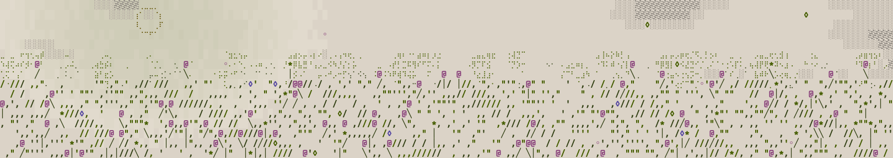

# Contributing

This is a small codebase with a high bar. Both modes run on an audio thread, and both play what Folium's oscillator plays, sample for sample before the declick on the reference build, with Folium's per-voice variation turned off. The rules below are the bar for every change. Read them before opening a pull request; a change that breaks one is not merged, however good it sounds.

## The contract the code keeps

- **Header-only, C++17, no dependencies.** `core.hpp` and `analog.hpp` include `<algorithm>`, `<cmath>` and `<cstdint>` from the standard library and nothing else; `declick.hpp` includes only `<cmath>`; `oscillator.hpp` adds `<vector>`, for the tables it builds once; `scl.hpp` includes `<cstddef>`, `<cstdio>` and `<cstring>`. `mts_esp.hpp` is the one file that reaches outside, and only for ODDSound's client.
- **Nothing allocates after construction.** No `new`, no containers that grow, no `std::function` on the process path. Tables are built once, when the first oscillator is made.
- **Nothing locks, nothing calls the system.** No mutex, no I/O, no logging on the process path. File reading lives in `scl.hpp` and runs off the audio thread.
- **Per sample, any block, any rate.** `process()` once per sample or `process(out, n)` for any `n`, from 8 kHz to 192 kHz. The output never depends on how the host slices its blocks: control-rate work runs every `kControlBlock` samples counted from the last `reset()` or `noteOn()`, never from the buffer boundary.
- **Bad values are ignored.** A value that is not finite, given to `noteOn()`, `setFrequency()` or any setter that takes a float, is dropped and the last good one kept, because a NaN that reached a smoother or a phase would stay there until the next reset.
- **No new parameter range without its formula.** A range comes from the engine's maths or from a shipping instrument, and the derivation goes in the commit.
- **The check stays green.** Run `sh tests/check.sh` before and after. On the reference build in `MODES.md` every row passes; on any other build the match rows can fail and everything else passes. How far the sound moves there is in `MODES.md`: with Analog's cross FM, 24 dB under the peak within two seconds, and still growing on longer notes. If a change moves the sound on purpose, it moves in Folium first, the references are written again from Folium's render, and the pull request says which rows moved and why. `sh tests/check.sh --arms` breaks the headers on purpose in a copy and requires each check to go red, so a check that cannot fail is caught too.

## Style

- Plain names that say what a thing is. `syncRatio`, not `sr`. No abbreviations the next reader has to decode.
- Comments say why. A comment that restates the line below it is deleted.
- One idea per function. If a function needs a scroll bar, split it.
- `float` on the signal path, `double` where a ratio or a frequency is worked out once at control rate.
- Constants are named, with their unit and their source in the comment.
- A few ASCII flowers in the file headers. They are the signature of this project; keep them small, keep them rare.

## Credit

- A technique is cited in `CREDITS.md` to the paper or the instrument it came from.
- No code is transcribed from another maker's product, source or binary. When a method is shared with another instrument, it is written here from the principle.

## Pull requests

- One change per pull request. A refactor and a sound change never travel together.
- Say what you heard and what you measured. A pull request that changes the sound includes a before and after render.
- Commits in plain words, present tense, saying what changed and why.
- A change for one host (JUCE, Rack, an embedded target) goes under `examples/`, and the headers stay host-free.

## Reporting a problem

Open an issue with the mode, the sample rate, the block size, the tuning file and the parameter values that reproduce it. A WAV of what you heard helps; the command line that rendered it helps more.
