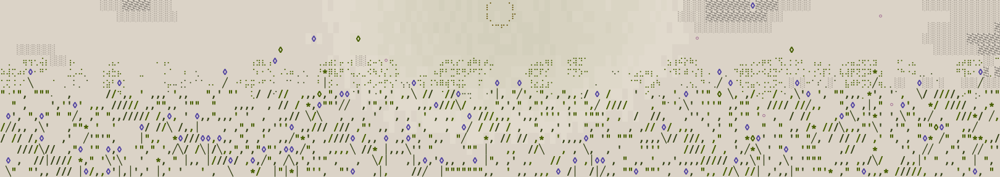

# Credits

The Petal Oscillator stands on other people's ideas. Where a technique came from a paper or an instrument, it is named here and the code is my own writing of it.

## The idea

- John Chowning, "The Synthesis of Complex Audio Spectra by Means of Frequency Modulation", Journal of the Audio Engineering Society 21(7), 1973. Everything in Complex that rings is his idea.
- Don Buchla, the 259 complex waveform generator: one oscillator modulating another, and knobs you can hear. The shape of Complex.
- The seven-voice unison in Analog is an idea from Roland's JP-8000 and its supersaw. The voice offsets and the mix are my own.

## The sine

- Marc Le Brun, "Digital Waveshaping Synthesis", Journal of the Audio Engineering Society 27(4), 1979, pp. 250 to 266. Chebyshev waveshaping, which puts the sine's third harmonic, a fifth above the octave, 38 dB under the fundamental.

The sine under it is my own: an odd 9th-order polynomial on the folded phase, fitted for the least harmonic energy, with the peak held at 1 and the wave smooth where the phase turns. On its own every harmonic sits more than 150 dB under the fundamental, and the waveshaping above puts the third back on purpose.

## The corrections in Analog

- V. Välimäki and A. Huovilainen, "Antialiasing oscillators in subtractive synthesis", IEEE Signal Processing Magazine 24(2), 2007, pp. 116 to 125. The polyBLEP that smooths every step.
- F. Esqueda, V. Välimäki and S. Bilbao, "Rounding corners with BLAMP", DAFx-16, Brno, 2016. The polyBLAMP that smooths every corner.
- E. Brandt, "Hard sync without aliasing", Proceedings of ICMC 2001, pp. 365 to 368. The order a sync pays its corrections in.

## The tuning side

- Manuel Op de Coul, the Scala `.scl` format. The files in `tunings/` and the reader in `scl.hpp` follow his specification, except that the reader takes at most 64 notes and, from a file, under 16 KB, and refuses a scale of zero notes and a scale whose last pitch is not above 1/1.
- ODDSound, MTS-ESP. `mts_esp.hpp` reads a live tuning from an MTS-ESP master through their client library, which is not included here and comes under ODDSound's own permissive licence (https://github.com/ODDSound/MTS-ESP).

## How I cite

A technique is credited to the person or paper it came from. No code here is transcribed from another maker's product. If you find a name missing, open an issue and I will add it.
