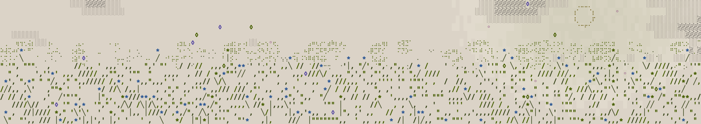

# Modes and versions

The Petal Oscillator has two modes, Complex and Analog. This page is what holds them to Folium, how the version number moves, and what has to be true before a release goes out.

## Every mode is Folium's

I built this oscillator inside Folium, my synthesizer, and that is where it is tuned and played first. The code here plays what Folium's oscillator plays, sample for sample before the declick, with Folium's per-voice variation turned off. That is the rule, and any difference from Folium is a fault to fix.

A change that moves what a mode plays goes into a Folium release and a release here together, so a pull request that changes the sound is not merged on its own. Ideas are welcome as issues. The licence is MIT, so fork it and build your own; that is what it is for.

## Versions

The version number follows the references. The match check holds a reference for every mode at every setting it tests, rendered from Folium, and what changed in those references decides the number. Versions are read on the reference build only.

- Major, 2.0.0: any sample of a mode changes, even by rounding, or a call is removed or changes what it does. Someone who built an instrument on the last version would hear it, or would have to change their code.
- Minor, 1.1.0: something is added, a parameter or a call, with every existing reference unchanged.
- Patch, 1.0.1: no reference changed. Documentation, examples, the build, or a fix that moves no sample.

Every release is a tag on `main`, and `main` only ever holds a released state. The two version numbers are separate, and each release names the Folium release it matches:

| Petal Oscillator | Folium |
|---|---|
| 1.0.0 | 1.1 |

The references for 1.0.0 are rendered from Folium 1.1, and the match is run against Folium's release tag before this version is tagged.

## What equal means

Equal is every sample from the first, the onset and changing notes included, at the oscillator's own output, before anything Folium runs after it, on the reference build: Apple clang 21.0.0 (clang-2100.1.1.101), `-std=c++17 -O2`, arm64, Apple M4 Pro. Folium's per-voice variation and velocity are off in every reference; the open oscillator has none of them. The two are compared with no offset, so a change in the delay the oscillator adds to its own output counts as a difference.

A reference is a hash of every 1,024-sample stretch of a setting's render, so a break is found to its stretch.

Equal holds on the reference build. Another compiler or processor rounds floating point its own way, so there the match rows can fail while every other check passes. How far the sound moves depends on the mode, measured under the table. On the reference machine, 72 match rows each:

| Build | Match rows that fail |
|---|---|
| the reference, arm64 `-O2` | 0 |
| x86_64 (`-arch x86_64`, run under Rosetta) | 52 |
| arm64 `-O2 -ffp-contract=off` | 52 |
| arm64 `-O2 -ffp-contract=fast` | 72 |
| arm64 `-O0` | 6 |
| GCC 15.2, arm64 `-O2` | 72 |
| GCC 15.2, arm64 `-O2 -ffp-contract=off` | 52 |

The reference build fuses a multiply and an add inside one statement. x86 and `-ffp-contract=off` never fuse, and `-ffp-contract=fast`, which is GCC's default, fuses across statements too. Measured over two seconds at 48 kHz, x86 (under Rosetta) and GCC 15.2 against the reference:

- Complex, and Analog without cross FM: 104 to 135 dB under the signal.
- Analog with cross FM: it moves osc 1's rate and osc 1's phase adds that up, so a difference in the last bits grows over the note. Cross 0.4: 83 dB under the signal's RMS, 61 dB under its peak. Cross 1 with osc 2 at ratio 1.5: 57 and 34 dB. A full patch (unison 1, detune 40, sub 0.4, sync 2.3, osc 2 level 0.6 at ratio 1.5, ring 0.3, cross 0.4): 60 and 24 dB.
- Held for 30 seconds at cross 1 with osc 2 at ratio 1.5, built arm64 `-O2 -ffp-contract=off` (on the settings above it gives x86's numbers to the decimal): still growing, 43.6 dB under the RMS over the last three seconds and 22.8 dB under the peak at its worst. Over the last 0.68 s of a two-second note at the same setting, every partial within 40 dB of the loudest is within 0.12 dB of the reference's: the builds drift apart in timing, not in level.
- Whether any of this can be heard has not been tested.

MSVC has not been run. On a build other than the reference, the check does not yet compare the sound: it reports the match rows as failed and holds every other check as usual.

## The checks

All of them run in a few seconds with `sh tests/check.sh`. `sh tests/check.sh --arms` then breaks one real line of a copy of the headers for each check, and requires that check, and no other, to fail.

- Match: every mode against its references, at 44.1, 48 and 96 kHz. A missing reference fails; it is never skipped.
- Blocks: the same notes rendered in blocks of 1, 7, 64 and 512 samples come out identical.
- Rates: pitch measured at ten rates from 8 kHz to 192 kHz, and every sample finite.
- Bad input: NaN and infinity into every setter, the last good value kept, every sample finite.
- Declick: the onset window and the DC blocker against their formulas, at 44.1, 48 and 96 kHz.
- Window: each mode runs its own onset window at the rate it is set to, and ducks a sounding note before the next, read at 96 kHz.
- Scala: a ratio typed with spaces, `3 / 2`, is refused rather than read as 3.
- Builds alone: every header but `mts_esp.hpp`, which needs the MTS-ESP client, compiles on its own as C++17 with `-Wall -Wextra -Werror`.

Stricter warnings are not part of the check. With clang 21 and `-Wpedantic -Wshadow -Wconversion -Wsign-conversion -Wdouble-promotion -Wold-style-cast -Wfloat-equal` added, the headers print six: five in `core.hpp` at lines 193 and 200 (`-Wimplicit-int-float-conversion` and `-Wdouble-promotion`), which stays byte for byte as Folium has it, and one `-Wfloat-equal` in `oscillator.hpp`, an exact compare that is meant. GCC with the same flags has not been counted.

`-ffast-math`, measured with clang 21 at `-O3`. Through the script, `CXXFLAGS="-O3 -ffast-math" sh tests/check.sh` does not build: the check's own NaN inputs in its bad-input block are an error under `-Werror` with finite maths on (exit 2). Built by hand without `-Werror`, `c++ -std=c++17 -O3 -ffast-math -Iinclude tests/check.cpp`: the two window rows and all 72 match rows fail. With `-fno-finite-math-only` added, only the 72 match rows fail. The bad-input row passed in both hand builds. So build with `-fno-finite-math-only` beside `-ffast-math`. GCC and MSVC with fast maths have not been run.

A release goes out when every check passes on `main` on the reference build, and the match holds against the tagged Folium release it names.
