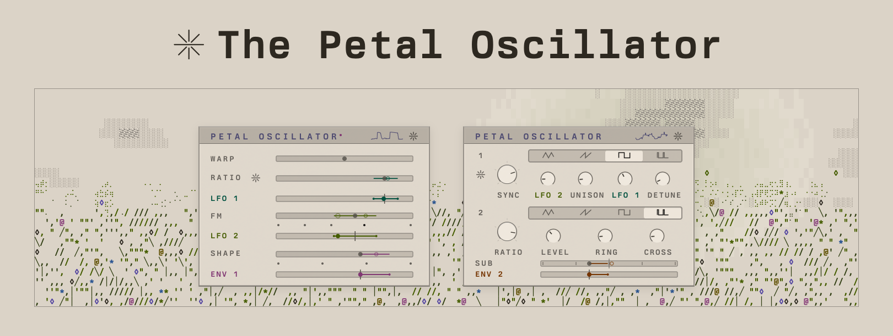
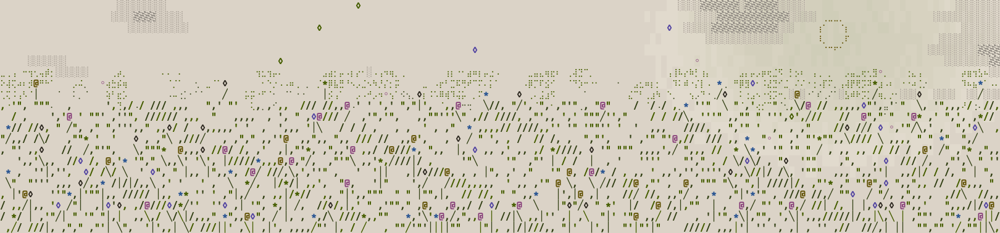

<p></p>

[Try it](#try-it)&emsp;[Use it](#put-it-in-your-instrument)&emsp;[With an assistant](#with-an-assistant)&emsp;[How close it is to Folium](#how-close-it-is-to-folium)&emsp;[Modes and versions](MODES.md)

This is the oscillator module from Folium, as a standalone open source module, so you can build with it too. It has two modes, Complex and Analog, and both of them listen to your loaded microtuning and respond accordingly: load 31-EDO, or a just scale, or something you made yourself, and the ratios inside the oscillator lock to the intervals you're playing in.

It's MIT licensed, header-only C++17, with no dependencies. Drop it into a JUCE plugin, a VCV Rack module, a Daisy module, or your own custom engine. The point of making this open source is to let people build whatever they want with it.

## Why it exists

For a long time (years) I kept asking the same question: what if a microtuning did more than set the pitch? What if the scale I loaded reached into the FM ratios, the filters and the modulation, so the whole instrument snapped to the intervals I was playing in? Why is tuning treated as a series of pitches when it could possibly be a lot more?

I chased it for years with other synths and a growing pile of custom Max devices, mostly for computing a tuning's ratios, and then mapping them to whatever synth I was using at the time. Eventually, it got annoying to be fiddling around constantly with other synths' designs and limitations, so I built my own synthesizer - Folium. The oscillator is where that adventure started. I'm giving it away here because I think it would be cool if someone out there got started with their own microtuning experiments, or on an instrument design, effects, firmware, or Eurorack module of their own with it.

## The two modes

**Complex** is loosely based on a Buchla complex oscillator, with one oscillator modulating the other - and then it wanders off into weirder territory with tuning. Load up a microtuning, pick a few of its intervals, turn on the lock, and the modulator snaps to the nearest one. Simple ones like 3/2 sound sweet and bigger ones like 16/9 get more complex and metallic sounding, which is a lot of fun to explore once you have a scale you like. The carrier has three waves: a sine, Warp (`Wave::Skewed` in the code), where Shape walks it from the sine through a triangle and a square to a sine pushed over to one side, and Carrier, which is a bank of up to 48 partials sitting on the notes of your tuning, or on just the degrees you picked. Which basically means your timbre reflects the scale as well as the ratios. Fun for drones made with microtunings.

```cpp
petal::Oscillator osc;
osc.setRatio(1.37f);                // modulator to carrier, 0.5 to 16
osc.setRatioLock(true);             // snap the ratio to the garden
osc.setFm(0.06f);                   // depth, 0 to 0.2 cycles
osc.setFeedback(0.0f);              // the carrier on itself, -1 to 1
osc.setWave(petal::Wave::Skewed);   // Sine, Skewed or Carrier
osc.setShape(0.5f);                 // brightness within the wave, 0 to 1
```

**Analog** is two band-limited oscillators, like the pair you'd find on an analog polysynth. The first sweeps from a triangle through a saw and a square to a thin 10% pulse. Turning up the sync gives you that classic sync sweep. You can spread it into a unison of up to seven voices and throw a square sub underneath it, one octave down or two. The second oscillator plays the same sweep at its own ratio, and you can mix it in, ring mod it against the first, or let it bend the first one's rate for some cross FM. With the lock on, the sync ratio and the second oscillator's ratio both snap to your scale, so a sync sweep lands on the tuning intervals.

```cpp
petal::AnalogOscillator analog;
analog.setWave(0.333f);             // 0 triangle, 1/3 saw, 2/3 square, 1 a 10% pulse
analog.setSync(1.37f);              // hard-sync ratio, 0.5 to 16, 1 is no sync
analog.setSyncLock(true);           // snap the sync and the second ratio to the garden
analog.setUnison(0.5f);             // 0 one voice to 1 seven
analog.setDetune(25.0f);            // the outer pair at full unison, 0 to 200 cents
analog.setSub(0.5f);                // 0 to 1 an octave under, 0 to -1 two octaves under
analog.setWave2(0.333f);            // the second oscillator, the same sweep
analog.setRatio2(1.5f);             // against the note, 0.5 to 16
analog.setLevel2(0.6f);             // in the mix, 0 to 1
analog.setRing(0.0f);               // toward the two multiplied, 0 to 1
analog.setCross(0.0f);              // the second bends the first one's rate, 0 to 1
```

The garden is the set of ratios a lock lands on. Pick up to eight scale degrees yourself, or pick none and it looks through the first twelve notes of your scale for the simplest whole number ratios, adds 2, 3 and 4, and keeps eight. On a bigger scale like 31-EDO those twelve notes stop short of the fifth, so pick your degrees there.

## Try it

```sh
cmake -B build -DCMAKE_BUILD_TYPE=Release && cmake --build build
./build/render_wav --scl tunings/edo31.scl --ratio 1.37 --lock --out complex.wav
./build/render_wav --mode analog --scl tunings/edo31.scl --sync 1.37 --lock --out analog.wav
```

That plays middle C in 31-EDO in each mode, the ratio at 1.37 with the lock on, and each one prints `ratio 1.2500 (locked)`: it landed on 5/4. Every option is listed at the top of `examples/render_wav.cpp`. No CMake? `c++ -std=c++17 -O2 -Iinclude examples/render_wav.cpp -o render_wav` does the same.

## Put it in your instrument

Copy `include/petal/` into your project, or add the repo as a CMake subdirectory and link `petal_oscillator`.

```cpp
#include "petal/oscillator.hpp"
#include "petal/scl.hpp"

petal::Tuning tuning;
petal::loadScl("tunings/edo31.scl", tuning);   // off the audio thread

petal::Oscillator osc;
osc.setSampleRate(48000.0f);
osc.setTuning(&tuning);
osc.setRatio(1.37f);
osc.setRatioLock(true);
osc.noteOn(static_cast<float>(tuning.noteToFrequency(60)));

osc.process(out, numSamples);                  // in your audio callback
```

Analog works the same way with `#include "petal/analog.hpp"` and `petal::AnalogOscillator`. Each mode is one voice and sound source. You have to bring/create your own envelope and VCA, the way you would patch one up on a modular.

A tuning comes from a `.scl` file, from your own ratios with `tuning.setFromIntervals()`, or live from an MTS-ESP master through `petal/mts_esp.hpp`. With no tuning it plays 12-TET at A4 = 440 Hz.

Each note rises in over 5.33 ms (256 samples at 48 kHz) and runs through a DC blocker at the end. If you put a folder of your own after the oscillator, call `setDeclickInside(false)` and run `osc.declick()` on your output instead, so the rise and the blocker come last, the way they do in Folium. Tell Complex how hard the folder folds with `setFoldAfter(1 to 8)`, so the skewed wave leaves it room under Nyquist, and give the folder `osc.sidechain()` if it wants the fundamental's phase, frequency and level. 

`examples/` has the WAV renderer, a small eight voice JUCE instrument and a madronalib sketch.

## With an assistant

Point your coding assistant at the index and tell it what you're building:

```
Read https://github.com/PetalsFM/petal-oscillator/raw/main/llms.txt, then add the Petal Oscillator to my JUCE synth, one per voice.
```

`AGENTS.md` is the contract for an agent working inside this repo, and `prompts/` holds a complete first message for JUCE, VCV Rack, madronalib and Daisy.

## The tunings

`tunings/` has five Scala files: 12-EDO, 31-EDO, 5-limit just intonation, a Pythagorean major scale named for the kora (it is not a measured kora tuning), and a 31-tone scale of mine. Any `.scl` of 1 to 64 notes loads.

## How close it is to Folium

Both modes play what Folium's oscillator plays, sample for sample before the declick, with Folium's per-voice variation shenanigans turned off. I (tbh my agents) rendered the two side by side, 11 settings of Complex and 17 of Analog at 44.1, 48 and 96 kHz, note starts and notes that change while they sound included, and every sample came out the same from the first one. `tests/references.txt` keeps 72 of those renders as numbers and `sh tests/check.sh` holds the repo to them, so if the sound ever moves, the check fails and says where.

What I haven't tested yet: MSVC, an Intel machine, the MTS-ESP adapter against a running master, the madronalib example, and the JUCE example inside a host (it builds as a standalone app against JUCE 8.0.4 on an M4 Pro). The renders match to the bit on the build I made them with, Apple clang at `-O2` on an M4 Pro. Other builds round floating point their own way, so some renders differ there and `sh tests/check.sh` reports them, while every other check passes. Built for x86_64 and run under Rosetta on the same M4 Pro, 52 of the 72 differ, because Apple's ARM compiler fuses a multiply and an add where x86 doesn't. With GCC 15.2 on arm64, all 72 differ at `-O2` and 52 with `-ffp-contract=off`. How far apart depends on the mode. Complex, and Analog without cross FM, stay 104 to 135 dB under the sound on the x86 and GCC renders I compared. Analog's cross FM doesn't: it moves the first oscillator's rate, and the phase adds that up over the note, so two builds drift apart in timing. On a full Analog patch the difference reached 24 dB under the peak within two seconds, and on a 30 second note at full cross FM it was still growing, to 23 dB under the peak. At full cross FM over two seconds the partials stayed within 0.12 dB of each other. So it is the timing that moves, not the balance. I haven't listened for it. `MODES.md` has the numbers for each build. If something breaks for you, or if you find something interesting, I'd love to hear about it.

## Modes and versions

It has two modes, Complex and Analog. `MODES.md` says how each is held to Folium and how versions move.

## Thanks

<p></p>

John Chowning for FM, Don Buchla for the complex oscillator, Manuel Op de Coul for the Scala format and ODDSound for MTS-ESP. Randy Jones for Madronalib and Aalto. The papers behind the sine and Analog's corrections are in `CREDITS.md`.

MIT, see `LICENSE`. The code is free to use in anything you like. The names Petals, Petal Oscillator and Folium are ours, so please don't put them on what you make without asking.

Made by Sheryar Hyatt (aka Shades) at Petals. shades@petals.fm
